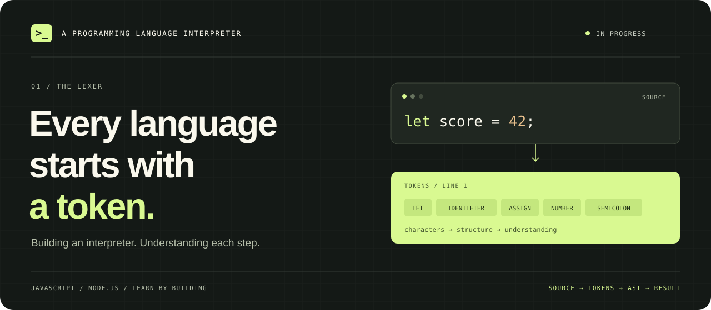

<p align="center">
  
</p>

<h1 align="center">A Programming Language Interpreter</h1>

<p align="center">
  From a string of characters to a program that runs.<br />
  Building an interpreter for a subset of JavaScript, one stage at a time.
</p>

<p align="center">
  <strong>JavaScript</strong> &nbsp; / &nbsp; <strong>Node.js</strong> &nbsp; / &nbsp; <strong>Lexer in progress</strong>
</p>

<p align="center">
  <a href="#see-it-in-action">Try the lexer</a> &nbsp; · &nbsp;
  <a href="#inside-the-lexer">How it works</a> &nbsp; · &nbsp;
  <a href="#the-road-ahead">Roadmap</a> &nbsp; · &nbsp;
  <a href="a-programming-language-interpreter/lexer.js">Read the code</a>
</p>

---

## The idea

What actually happens between writing `let score = 42;` and a computer understanding it?

This project explores that question by building the pieces of an interpreter in JavaScript. The first piece is the **lexer**: it reads source text character by character and turns it into meaningful tokens.

The longer-term goal is a tree-walk interpreter with a parser, variable scopes, and an evaluator. **Right now, this repository contains the lexer and project notes.**

## See it in action

Give the lexer a line of source:

```js
let score = 42;
```

It produces these tokens:

| Type | Value | Line |
| :--- | :--- | :---: |
| `LET` | `"let"` | 1 |
| `IDENTIFIER` | `"score"` | 1 |
| `ASSIGN` | `"="` | 1 |
| `NUMBER` | `42` | 1 |
| `SEMICOLON` | `";"` | 1 |
| `EOF` | `null` | 1 |

### Try it locally

You'll need **Git and Node.js**. There are no npm dependencies to install.

```bash
git clone https://github.com/Uttkarshchambiyal/a-programming-language-interpreter.git
cd a-programming-language-interpreter
```

The lexer currently defines classes without exporting them or providing a command-line entry point. Run this from the repository root to load it into a Node.js sandbox and print the example tokens:

```bash
node <<'NODE'
const fs = require('node:fs');
const vm = require('node:vm');

const source = fs.readFileSync(
  'a-programming-language-interpreter/lexer.js',
  'utf8'
);

vm.runInNewContext(
  `${source}\nconsole.table(new Lexer('let score = 42;').tokenize());`,
  { console }
);
NODE
```

Change `let score = 42;` in the last snippet to explore other inputs.

## Inside the lexer

```text
  SOURCE TEXT               LEXER                     TOKENS
  ───────────               ─────                     ──────
  "let score = 42;"   →   scan characters   →   LET · IDENTIFIER · ASSIGN
                         recognize patterns    NUMBER · SEMICOLON · EOF
                         track line numbers
```

Three building blocks keep the implementation easy to follow:

| Building block | Responsibility |
| :--- | :--- |
| `TokenType` | Names the token categories. |
| `Token` | Holds a token's `type`, `value`, and `line`. |
| `Lexer` | Scans the source and builds the token array. |

`peek()` looks at the current character. `advance()` consumes it. Dedicated methods read numbers, words, and strings; `tokenize()` ties the steps together.

### What it handles today

- Whole numbers, double-quoted strings, booleans, and identifiers.
- `let` declarations and the assignment operator `=`.
- Arithmetic symbols: `+`, `-`, `*`, `/`.
- Comparisons: `!=`, `!==`, `<`, `>`, `<=`, `>=`.
- Logical symbols: `!`, `&&`, `||`.
- Parentheses, braces, brackets, commas, dots, and semicolons.
- Spaces, tabs, newline tracking, and an end-of-file token.

These are **tokenization capabilities**; the project does not execute expressions or statements yet.

### Still being built

Some keyword branches and the `==` / `===` branches reference token types that have not been defined yet. Decimal numbers, string escapes, comments, and error reporting also need work. Unrecognized characters are currently skipped, and unterminated strings are not reported as errors.

## The road ahead

```text
  01  LEXER         02  PARSER         03  ENVIRONMENT      04  EVALUATOR
      in progress       planned             planned             planned
      characters        tokens              bindings            AST
      ↓                 ↓                   + scopes            ↓
      tokens            syntax tree                             result
```

- [x] Build the token model and character-scanning helpers.
- [x] Add the initial lexer for literals, identifiers, and operators.
- [ ] Complete token definitions and lexer error handling.
- [ ] Add lexer tests and a reusable module entry point.
- [ ] Build a parser with expression precedence.
- [ ] Add variable environments and evaluate the syntax tree.
- [ ] Introduce control flow, functions, and closures.
- [ ] Add an interactive REPL and a file runner.

The broader language plan is in the [project notes](a-programming-language-interpreter/CLAUDE.md). Its proposed `src/` files and run commands describe future stages.

## Find your way around

```text
.
├── README.md
├── assets/
│   └── readme-hero.svg
└── a-programming-language-interpreter/
    ├── CLAUDE.md          # Learning notes and planned language features
    └── lexer.js           # Current implementation
```

To check the JavaScript syntax:

```bash
node --check a-programming-language-interpreter/lexer.js
```

There is no automated test suite yet. A syntax check confirms that the file parses; it does not verify every tokenization case.

---

<p align="center">
  <strong>Read a character. Find a pattern. Build a language.</strong><br />
  A learning project by <a href="https://github.com/Uttkarshchambiyal">Uttkarsh Chambiyal</a>.
</p>
