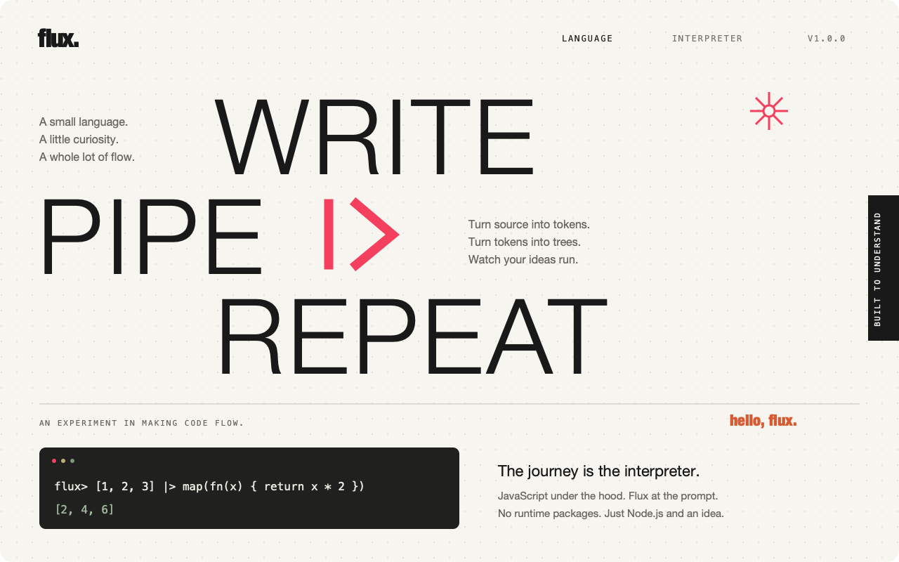

<p align="center">
  
</p>

<h1 align="center">Flux</h1>

<p align="center">
  A small programming language for following an idea all the way through.<br />
  Handwritten lexer. Recursive-descent parser. Tree-walk interpreter.
</p>

<p align="center">
  <strong>JavaScript</strong> &nbsp; / &nbsp; <strong>Zero runtime dependencies</strong> &nbsp; / &nbsp; <strong>Pipeline syntax</strong>
</p>

<p align="center">
  <a href="#start-here">Start here</a> &nbsp; · &nbsp;
  <a href="#follow-the-flow">The language</a> &nbsp; · &nbsp;
  <a href="#under-the-hood">Under the hood</a> &nbsp; · &nbsp;
  <a href="examples">Examples</a>
</p>

---

## Small syntax. Room to explore.

Flux is an experimental interpreter written in JavaScript. It takes a `.flux` file—or a line typed at the prompt—and runs it through a lexer, parser, and evaluator. The implementation is small enough to read from beginning to end.

Its signature is `|>`: pass a value into a function, then keep going.

```text
[1, 2, 3, 4, 5] |>
  map(fn(x) { return x * 2 }) |>
  filter(fn(x) { return x > 5 }) |>
  print

-- [6, 8, 10]
```

## Start here

You need **Node.js** and Git. The examples have been verified with Node.js **v24.13.0**. There are no npm dependencies to install.

```bash
git clone https://github.com/Uttkarshchambiyal/a-programming-language-interpreter.git
cd a-programming-language-interpreter

# Run your first Flux program
npm run run -- examples/hello.flux

# Or open the interactive prompt
npm start
```

The hello example prints:

```text
Hello, World!
[2, 4, 6, 8, 10]
[4, 5]
```

At the prompt, try `5 |> str` or `[1, 2, 3] |> len`. Values persist between entries. The REPL evaluates **one line at a time**; use a `.flux` file for multiline programs. Press **Ctrl+C** to exit.

Run any file directly:

```bash
node src/repl.js path/to/program.flux
```

## Follow the flow

### 01 / Values and decisions

Declare variables with `let`, reassign them with `=`, and use `--` for comments. Flux has numbers, strings, booleans, `null`, arrays, and functions.

```text
let name = "World"
"Hello, " + name + "!" |> print

let score = 82
if score >= 90 {
  print("Excellent")
} elif score >= 60 {
  print("Keep going")
} else {
  print("Try again")
}
```

Arithmetic uses `+`, `-`, `*`, `/`, and `%`. Comparisons use `==`, `!=`, `<`, `>`, `<=`, and `>=`. Combine conditions with `and`, `or`, and `not`. Arrays and strings support zero-based indexing, such as `[10, 20, 30][1]`.

### 02 / Functions that remember

Functions are values. Pass them around, return them, and capture variables from their surrounding scope.

```text
fn counter(start) {
  let count = start
  return fn() {
    count = count + 1
    return count
  }
}

let next = counter(0)
next() |> print  -- 1
next() |> print  -- 2
next() |> print  -- 3
```

### 03 / One value, one direction

The pipeline passes the value on the left as the **first argument** of the function on the right. Extra arguments follow it: `items |> map(transform)` behaves like `map(items, transform)`.

For a multiline pipeline, place `|>` at the end of each continued line, as below.

```text
fn double(x) {
  return x * 2
}

5 |> double |> str |> print  -- 10

range(1, 6) |>
  map(fn(x) { return x * x }) |>
  reduce(fn(total, x) { return total + x }, 0) |>
  print  -- 55
```

### 04 / A little repetition

```text
let i = 1
while i <= 3 {
  i |> print
  i = i + 1
}
```

## The small standard library

| Function | What it does |
| :--- | :--- |
| `print(...values)` | Print values separated by spaces. |
| `len(value)` | Get the length of a string or array. |
| `push(array, value)` | Append an item in place and return the array. |
| `pop(array)` | Remove and return the final item. |
| `map(array, fn)` | Return an array of transformed values. |
| `filter(array, fn)` | Return values that satisfy a predicate. |
| `reduce(array, fn, initial)` | Fold an array into an accumulated value. |
| `range(end)` / `range(start, end)` | Create integers from the start, inclusive, to the end, exclusive. The default start is `0`. |
| `type(value)` | Return a value's type as a string. |
| `str(value)` / `num(value)` | Convert a value to a string or number. |

## Under the hood

```text
  YOUR CODE         TOKENS           SYNTAX TREE         RESULT
  ─────────         ──────           ───────────         ──────
  program.flux  →   Lexer      →     Parser        →    Interpreter
                                                        ↕
                                                    Environment
```

| File | Responsibility |
| :--- | :--- |
| [`src/lexer.js`](src/lexer.js) | Turn characters into tokens and track source positions. |
| [`src/parser.js`](src/parser.js) | Build an abstract syntax tree with operator precedence. |
| [`src/interpreter.js`](src/interpreter.js) | Evaluate the tree and provide built-in functions. |
| [`src/environment.js`](src/environment.js) | Resolve variables through parent scopes and support closures. |
| [`src/repl.js`](src/repl.js) | Run files or keep an interactive session alive. |

## Take it for a spin

| Program | Explore |
| :--- | :--- |
| [`hello.flux`](examples/hello.flux) | Strings, arrays, `map`, `filter`, and pipelines. |
| [`fizzbuzz.flux`](examples/fizzbuzz.flux) | Functions, branching, modulo, and a `while` loop. |
| [`closures.flux`](examples/closures.flux) | Independent counters, captured state, and higher-order functions. |

```bash
node src/repl.js examples/hello.flux
node src/repl.js examples/fizzbuzz.flux
node src/repl.js examples/closures.flux
```

## Current edges

This is a learning project with a working interpreter and example programs. A few things are still unfinished:

- **Automated tests:** `npm test` is configured, but no test files are included yet; the command currently fails.
- **Input:** `input()` is registered as a placeholder and throws an error, including in the current REPL.
- **Interactive editing:** multiline input is not supported at the prompt.
- **Loop limit:** a `while` loop stops with a runtime error after exceeding 100,000 iterations.

The next useful contributions are a test suite, multiline REPL input, and a working `input()` implementation. Open an [issue](https://github.com/Uttkarshchambiyal/a-programming-language-interpreter/issues) or a pull request to discuss an idea.

---

<p align="center">
  <strong>Write something small. See how far it flows.</strong><br />
  Created by <a href="https://github.com/Uttkarshchambiyal">Uttkarsh Chambiyal</a>
</p>
