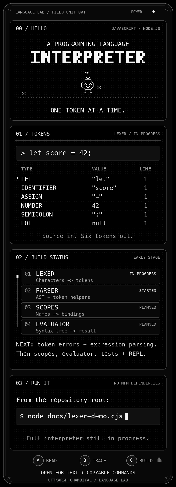

<!-- All visible README content lives inside the animated LCD console.
     Edit scripts/render_readme.py, then run it with Python 3 + Pillow.
     The linked guide provides selectable text, source links and commands. -->

  <a href="docs/GUIDE.md" title="Open the project guide and copyable commands">
    <picture>
      <source media="(prefers-reduced-motion: reduce)" srcset="assets/readme/console-still.png" />
      
    </picture>
  </a>

